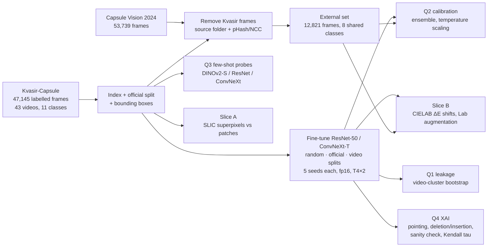
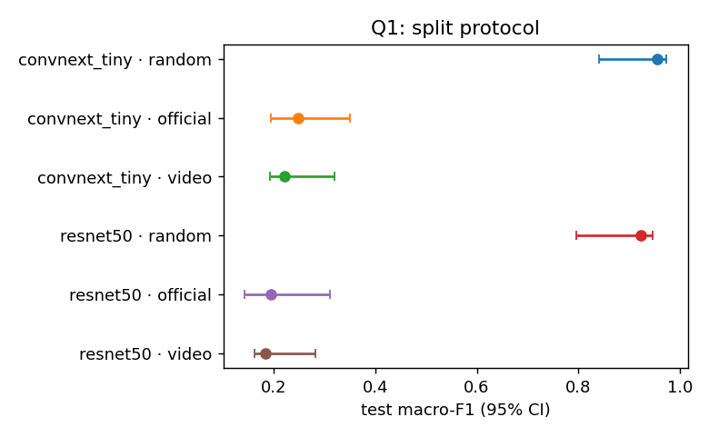
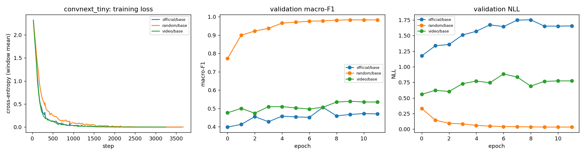
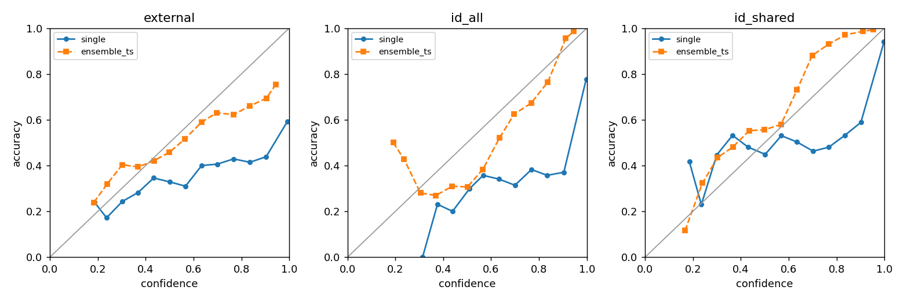
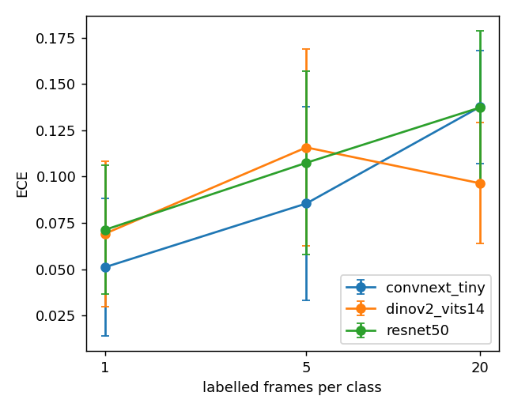
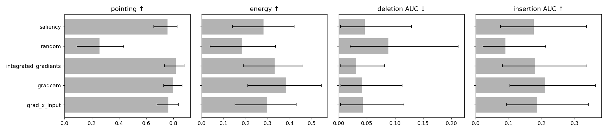
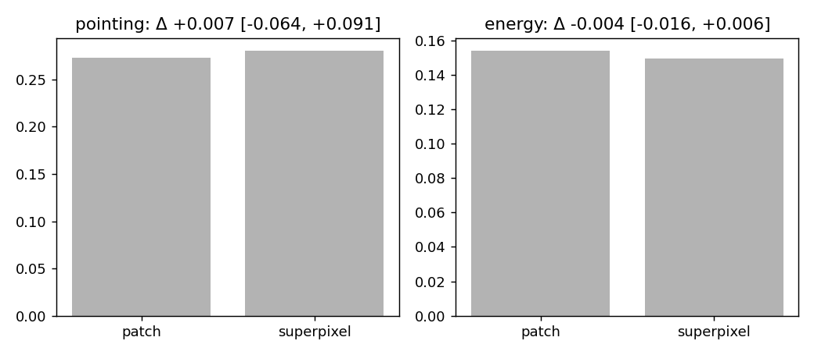
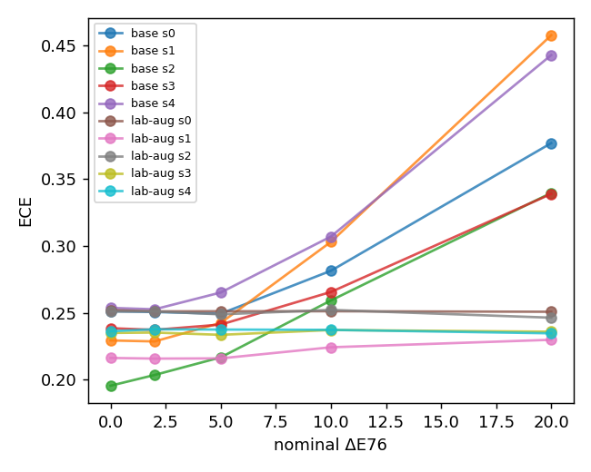

# capsule-xai-audit

**How much do standard results in capsule endoscopy depend on how the data is split, how the
model is calibrated, and which explanation method is used?**


This repository is an audit, not a new model. It takes the usual pipeline for wireless
capsule endoscopy (fine-tune an ImageNet backbone, report macro-F1, show a saliency map)
and measures how much each step changes the conclusion. Kvasir-Capsule is the
in-distribution dataset. Capsule Vision 2024, after removing every frame it shares with
Kvasir-Capsule, is the external set. The hypotheses were committed before any experiment
code (see [Pre-registration](#pre-registration)). Every result is reported, including
negative ones.

**Jump to:** [Results](#results) · [Improvements](#improvements-and-next-steps) ·
[Reproducing](#reproducing) · [Pre-registration](#pre-registration) · [Limitations](#limitations)

## TL;DR

| | Result (ConvNeXt-T, 5 seeds, test fold 1, 95% CI) |
| --- | --- |
| **Split leakage** | A random frame-level split reports macro-F1 **0.955**. The official split reports **0.247**. The difference of 0.71 [0.54, 0.76] comes from near-identical neighbouring frames on both sides of the split. |
| **Official split** | 7 of the 43 videos sit in both official folds. Moving them to one side changes macro-F1 by only 0.03 [−0.08, 0.12], so that overlap does not inflate the published split. |
| **Calibration under shift** | A 5-model ensemble cuts external ECE from 0.337 to 0.209. Temperature scaling fitted in-distribution does not close the gap for a single model: external ECE stays 0.089 [0.056, 0.102] above in-distribution ECE. |
| **Colour shift** | ECE rises steadily with a simulated CIELAB shift: about +0.008 per ΔE for ResNet-50, from ≈0.23 at ΔE 0 to ≈0.39 at ΔE 20. Lab-space augmentation flattens the slope to ≈0. Matching global colour statistics does not recover the real external gap. |
| **Explanations** | Grad-CAM passes the weight-randomisation sanity check. Integrated Gradients and Gradient×Input keep a Spearman correlation of 0.34–0.42 with their original maps after every weight is randomised. Method rankings are not stable enough to test H4. |

## Why this project

Capsule-endoscopy papers often report frame-level scores from random splits, uncalibrated
probabilities, and saliency maps as evidence of what the model sees. Each choice is easy to
make and hard to notice in a results table. This repository puts numbers on four such
choices under one fixed training recipe:

1. **Data splitting (Q1).** Random frame-level split vs the official patient/video split.
2. **Calibration (Q2).** Single model vs deep ensemble, with and without temperature scaling,
   on an external dataset from other hospitals and capsule devices.
3. **Label efficiency (Q3).** Linear probes on frozen DINOv2-S, ResNet-50 and ConvNeXt-T with
   1, 5 and 20 labels per class.
4. **Explanations (Q4).** Whether attribution methods ranked by "does the map point at the
   lesion" are ranked the same way by "does deleting the highlighted pixels change the
   prediction".

Two smaller slices extend the core:

- **Slice A.** Superpixel vs patch explanation units.
- **Slice B.** How much of the dataset gap is colour.

## What was done



- **Data.**
  - The pipeline indexes Kvasir-Capsule with its official two-fold split and bounding boxes.
  - It finds that the official split is not video-disjoint.
  - It removes Kvasir-Capsule frames from Capsule Vision 2024 two independent ways: by
    source folder, and by perceptual hash plus normalised cross-correlation. The two agree
    on 38,534 of 38,592 frames; the other 58 have no indexed Kvasir original.
  - No image is stored in this repository, only file lists, hashes and duplicate lists
    ([`manifests/`](manifests)).
- **Training.**
  - 45 runs: 2 backbones × 3 split protocols × 5 seeds, plus 5 ResNet-50 runs with Lab
    augmentation.
  - All runs use one recipe: class-weighted cross-entropy, fp16 autocast, early stopping on
    validation macro-F1, and checkpoints that resume after an interrupted Kaggle session.
  - The full run took 4.7 hours of wall-clock time on a Kaggle T4×2.
- **Statistics.**
  - Intervals resample whole videos, because neighbouring frames are almost identical.
  - Seed-to-seed variation is averaged inside each bootstrap replicate.
  - With fewer than 10 seeds or overlapping intervals, a result is called an *observation*.
- **Engineering.**
  - Typed configs and one `cxa` CLI.
  - Resumable runs that are skipped when already finished, and a one-command orchestrator
    with preflight and smoke stages.
  - 89 passing pytest tests on synthetic data that mimic both datasets' file formats.
  - ruff and mypy are clean.

## Results

All numbers below come from [`results/RESULTS.md`](results/RESULTS.md). `cxa report`
generates that file from the saved logits of the runs. Per-run values are in
[`results/training_runs.csv`](results/training_runs.csv) and the raw analyses in
`results/*.json`. Unless stated otherwise: train on official fold 0, test on fold 1,
5 seeds, 95% intervals.

### Verdicts

| Hypothesis | Verdict | Key number |
| --- | --- | --- |
| **H1** random split inflates macro-F1 | ✅ supported, both backbones | random − official = 0.71 [0.54, 0.76] (ConvNeXt-T), 0.73 [0.54, 0.77] (ResNet-50) |
| *added:* leakage inside the official split | ❌ not measurable | official − video = 0.03 [−0.08, 0.12] and 0.01 [−0.09, 0.11] |
| **H2a** ensemble beats single model on external data | ✅ supported, both backbones | ΔECE −0.128 [−0.132, −0.123], ΔNLL −0.95, ΔBrier −0.14 (ConvNeXt-T) |
| **H2b** temperature scaling does not close the external gap | ✅ for single models / ❌ for the ConvNeXt-T ensemble | single: +0.089 [0.056, 0.102]; ensemble: +0.015 [−0.027, 0.036] |
| **Q3** most label-efficient calibrated backbone | ⚪ no difference | all ECE intervals at k = 1 overlap |
| **H4** pointing and faithfulness rankings disagree | ⚪ inconclusive | ConvNeXt-T agrees (τ 0.6–1.0); ResNet-50 maps are near the random baseline |
| **HA** superpixels point better than patches | ❌ not supported | +0.007 [−0.064, 0.091], both near the random baseline |
| **HB1** ECE degrades monotonically with ΔE | ✅ observation | Spearman(ΔE, ECE) 0.6–1.0 in every base seed |
| **HB2** Lab augmentation reduces that slope | ✅ observation | Δslope −0.0081 [−0.0102, −0.0061] per ΔE |

### Q1 — Split leakage



| backbone | random | official | video | random − official |
| --- | --- | --- | --- | --- |
| ConvNeXt-T | 0.955 [0.842, 0.974] | 0.247 [0.193, 0.350] | 0.220 [0.193, 0.319] | **0.708** [0.539, 0.755] |
| ResNet-50 | 0.924 [0.797, 0.946] | 0.194 [0.142, 0.311] | 0.183 [0.162, 0.283] | **0.730** [0.540, 0.773] |

- **Split choice dominates.** A random split makes a mediocre classifier look nearly
  perfect: validation macro-F1 reaches 0.98. The protocol difference (≈0.7) is more than ten
  times the backbone difference.
- **The official split is the hard part.** Its folds are very unbalanced per class. For
  example, the training fold has 22 Blood frames and the test fold has 424. This, more than
  the 7 shared videos, explains the low absolute scores.
- **Validation is optimistic under the official protocol.** Validation macro-F1 is
  0.41–0.51, against 0.19–0.25 on test (see Deviation 4).



### Q2 — Calibration under dataset shift

Evaluated on the 8 classes shared by both datasets, with probabilities renormalised over them.

| ConvNeXt-T | ECE | NLL | Brier | macro-F1 |
| --- | --- | --- | --- | --- |
| in-distribution, single | 0.063 | 0.577 | 0.193 | 0.246 |
| external, single | 0.337 | 2.701 | 0.842 | 0.186 |
| external, single + TS | 0.154 | 1.633 | 0.719 | 0.186 |
| external, ensemble | 0.209 | 1.754 | 0.703 | 0.193 |
| external, ensemble + TS | **0.082** | **1.471** | **0.657** | 0.193 |

- **Ensemble and temperature scaling combine.** Each cuts external ECE substantially.
  Together they bring ConvNeXt-T within noise of its in-distribution calibration.
  ResNet-50 shows the same pattern with larger gaps: 0.421 → 0.126.
- **Accuracy does not recover.** External macro-F1 stays low (0.19 vs 0.25), so the gain is
  calibration, not accuracy.
- **The external set is mostly one source.** It is 95% SEE-AI frames, so "external" here
  mostly means *Kvasir-Capsule → SEE-AI*.



### Q3 — Few-shot linear probes



| backbone | k = 1 F1 | k = 5 F1 | k = 20 F1 | all labels F1 | ECE at k = 1 |
| --- | --- | --- | --- | --- | --- |
| DINOv2-S | 0.095 | 0.122 | **0.162** | **0.199** | 0.069 [0.022, 0.131] |
| ConvNeXt-T | 0.087 | 0.116 | 0.140 | 0.182 | 0.051 [0.019, 0.122] |
| ResNet-50 | 0.080 | 0.103 | 0.128 | 0.159 | 0.071 [0.016, 0.108] |

- **Ranking by accuracy.** DINOv2-S gives the best probe at every k.
- **No ranking by calibration.** ECE *increases* with k for all backbones. At k = 1 the
  probes are barely above chance and output low-confidence, nearly uniform probabilities,
  which gives a small ECE by construction. The pre-registered question therefore has no
  answer here.
- **Fine-tuning still wins.** Even with every label, the frozen probes stay below
  fine-tuning (0.247).

### Q4 — Explanation methods



300 frames with bounding boxes from 10 test videos; ConvNeXt-T, seed 0. The random
baseline's pointing score (0.257) is the share of frames where a random point lands in a box.

| method | pointing ↑ | deletion AUC ↓ | insertion AUC ↑ | sanity: Spearman after full randomisation (≈0 is good) |
| --- | --- | --- | --- | --- |
| Integrated Gradients | **0.817** | **0.031** | 0.180 | 0.416 ⚠️ |
| Grad-CAM | 0.800 | 0.042 | **0.211** | **−0.057** ✅ |
| Gradient × Input | 0.763 | 0.043 | 0.187 | 0.368 ⚠️ |
| Saliency | 0.757 | 0.046 | 0.176 | 0.233 |
| random | 0.257 | 0.088 | 0.090 | — |

- **Grad-CAM is the only method that passes the sanity check.** With every layer
  randomised, its map no longer resembles the trained one. Integrated Gradients and
  Gradient×Input keep a large part of their structure, a known failure for input-gradient
  products: their maps partly reflect the input image, not the model.
- **The models rarely get these frames right.** They classify 13% (ConvNeXt-T) and 10%
  (ResNet-50) of the boxed frames correctly. On a wrong frame the target-class probability
  starts near zero, so its deletion AUC is near zero whatever the map. The pooled
  deletion/insertion numbers are therefore dominated by wrong frames. On the 38 correct
  frames (5 videos), ConvNeXt-T keeps the same order: Integrated Gradients points best
  (0.95) and deletes fastest (0.22). The subset is too small for a finding.
- **H4 cannot be decided.** The Kendall τ values include the random baseline, which is last
  in nearly every ranking and inflates agreement. With five methods τ takes few distinct
  values, and the intervals span 0 to 1. ResNet-50 maps are close to the random baseline
  (pointing 0.33–0.43), so its rankings are mostly noise.

### Slice A — Superpixel explanation units



- **No effect.** Pooling DINOv2-S patch contributions to SLIC superpixels (mean 58 per
  frame) changes pointing by +0.007 [−0.064, 0.091].
- **Floor effect.** Both units sit near the random baseline (0.273 and 0.280 vs 0.257),
  because the frozen linear probe reaches only 0.197 macro-F1. The comparison needs a model
  that localises lesions in the first place.

### Slice B — Colour shift (simulation)



- **Calibration worsens with colour shift.** For the five base ResNet-50 models, ECE stays
  roughly flat up to ΔE 5 and then rises, from ≈0.23 to ≈0.39 at ΔE 20. The mean slope is
  +0.0082 per ΔE.
- **Lab augmentation removes the trend.** The five Lab-augmented models stay flat (slopes
  between −0.0002 and +0.0008). Their difference from the base models is
  −0.0081 [−0.0102, −0.0061] per ΔE.
- **Global colour is not the real gap.** Reinhard colour transfer maps the external
  images' Lab statistics onto Kvasir-Capsule. It recovers between −17% and +9% of the
  in-distribution → external ECE gap, i.e. none. For most runs the macro-F1 gap on the shared
  classes is under 0.05, too small to split.
- **This is a simulation.** There is no psychophysical validation and no display
  calibration.

## Improvements and next steps

Ordered by how much they would change the conclusions.

1. **Run the other fold direction (train 1 → test 0).** The pre-registration asked for both
   directions; only 0 → 1 was run (Deviation 7). The class imbalance between folds is
   extreme, so the reverse direction may move the absolute numbers.
2. **Re-analyse Q4 without the random baseline in τ, and on correct frames only.** It needs
   no GPU, because `runs/xai/**/per_image.csv` already holds per-frame scores. Also:
   - Normalise deletion/insertion by the starting probability, so wrong frames do not
     score as "faithful".
   - Explain the predicted class as a second target.
   - Sample boxed frames from both folds to raise the number of correct frames above 100.
3. **Report Q3 calibration at matched accuracy.** Add NLL, Brier and mean confidence next to
   ECE. Alternatively, compare backbones at the k where they reach equal macro-F1. As
   reported now, the ECE ranking mostly reflects confidence.
4. **Make the external intervals honest.** Capsule Vision ships without patient or video ids,
   so its bootstrap resamples frames and its intervals are too narrow. Recover sequence ids
   from SEE-AI file names or cluster frames by visual similarity, then resample clusters.
5. **Add a second external source.** The Capsule Vision 2024 test set (labels released in
   version 2) would reduce the reliance on SEE-AI. Kvasir-Capsule frames must be removed
   from it first, using the same dedup.
6. **Fix model selection under the official split.** Validation macro-F1 (0.41–0.51)
   overstates test (0.19–0.25). A leave-videos-out inner cross-validation, or selection on
   NLL instead of macro-F1, would choose epochs more reliably.
7. **Give Slice A a model that localises.** Repeat the patch vs superpixel comparison on the
   fine-tuned ConvNeXt-T (pointing ≈0.8) instead of a frozen probe at the random floor. If
   GPU budget allows, try SPiT / dHT.
8. **Close the loop in Slice B.** Evaluate the Lab-augmented models on the real external set,
   not only on simulated shifts, to test whether flatter colour sensitivity transfers. Add a
   ΔE2000 grid next to ΔE76.
9. **Repository hygiene.** Add a `LICENSE` file (the code is declared MIT in
   `pyproject.toml`) and GitHub Actions running `pytest`, `ruff` and `mypy`.


## Pre-registration

Registered on 2026-11-05, before any experiment was run. The git history shows this file and
`configs/class_mapping.yaml` committed before the experiment code. Any later change to a
hypothesis, metric or protocol is listed under *Deviations* below, with its date.

Every result is reported, including negative ones. With overlapping confidence intervals, or
with fewer than 10 positive cases, a result is reported as an *observation*, not a finding.

### Q1 — Split leakage

- **H1.** A random frame-level split gives a higher macro-F1 than the official
  Kvasir-Capsule split (two folds, each video in exactly one fold).
- Protocol: same trainer and hyper-parameters for both protocols; ResNet-50 and ConvNeXt-T;
  at least 3 (target 5) seeds; both fold directions (0→1, 1→0). The random split matches the
  official split's train/test sizes and class proportions.
- Metric: macro-F1 on the test fold. Effect = random − official, with a 95% CI from a
  video-cluster bootstrap.

### Q2 — Calibration under dataset shift

- **H2a.** On the external set, a 5-member deep ensemble has lower ECE, NLL and Brier score
  than a single model.
- **H2b.** Temperature scaling fitted on in-distribution validation data does not fully
  recover the external-set calibration loss: external ECE after scaling stays above
  in-distribution ECE after scaling.
- External set: Capsule Vision 2024 train+val, minus frames matched to Kvasir-Capsule by
  perceptual hash + normalised cross-correlation. Evaluation uses only the eight shared
  classes of `configs/class_mapping.yaml`, with probabilities renormalised over them.
- Metrics: top-label ECE (15 equal-width bins), NLL, multiclass Brier; macro-F1 for context.

### Q3 — Few-shot linear probes

- **Q3 (open question).** With a linear probe on a frozen backbone (DINOv2-S, ResNet-50,
  ConvNeXt-T) and k ∈ {1, 5, 20} labelled frames per class, which backbone stays best
  calibrated at the smallest k?
- Protocol: shots drawn from the training fold, spread across videos; 10 draws per k;
  evaluated on the other official fold.
- Metrics: ECE and macro-F1, mean and 95% interval over draws.

### Q4 — Explanation methods

- **H4.** The ranking of attribution methods by pointing game does not agree with their
  ranking by deletion/insertion faithfulness.
- Methods: Grad-CAM, Integrated Gradients, Saliency, Gradient×Input, plus a random baseline.
- Metrics: deletion and insertion AUC; similarity to attributions after cascading weight
  randomisation (sanity check); pointing game against the Kvasir-Capsule bounding boxes.
  Agreement between rankings is reported as Kendall's tau with a bootstrap interval.

### Slice A — Superpixel explanation units

- **HA.** On the same frozen model (so accuracy is identical by construction), attributions
  pooled to SLIC superpixels score higher on the pointing game than attributions on the
  patch grid.
- The superpixel adjacency graph is saved as an intermediate output.

### Slice B — Colour shift

- **HB1.** Calibration (ECE) degrades monotonically with a controlled CIELAB shift of
  ΔE ∈ {0, 2, 5, 10, 20}.
- **HB2.** Training with CIELAB colour augmentation reduces the slope of that degradation.
- Also reported: the share of the in-distribution → external gap recovered by matching the
  external images' Lab statistics to Kvasir-Capsule.
- This is a simulation: there is no psychophysical validation and no display calibration.

## Deviations

**2026-11-15, before any experiment run on real data.** Checking the downloaded releases
showed that three statements above do not hold; the protocol was changed as follows.

1. *The official split is not video-disjoint.* 7 of its 43 videos (7,944 of 47,161 rows)
   have frames in both folds; the split assigns each (video, class) pair, not each video,
   to one fold. Q1 therefore uses three protocols: `random`, `official` exactly as
   published, and `video`, in which each of the 7 videos moves whole to the fold holding
   most of its frames. `random − official` remains the pre-registered contrast for H1;
   `official − video` is added to measure the leakage left inside the official split. Q2,
   Q4 and Slice B keep using the official split, as registered.
2. *Kvasir-Capsule frames are removed from Capsule Vision by source folder.* The release
   stores every frame under `<Class>/<Source>/`, so `KVASIR` frames are removed exactly. The
   registered pHash + NCC matching is still run and any frame it flags is removed as well;
   the agreement of the two criteria is reported in `manifests/cv2024_dedup_summary.json`.
3. *Frames with two labels are excluded.* The official split lists 8 frames as both Erosion
   and Pylorus, and Capsule Vision stores some SEE-AI images under two class labels. The
   pipeline is single-label, so these frames are left out; both lists are in `manifests/`.

**2026-11-17, after the first full run on Kaggle (results discarded and re-run).**

4. *The validation split is no longer purely video-level.* Grouping it by video put the
   only Blood video of the training fold into validation (zero Blood frames to train on)
   and left the `video` protocol with a 2-video, 4-class validation set (val macro-F1 0.59
   against 0.24 on test). Validation now takes whole videos where possible and, for a class
   that would otherwise be missing from fit or validation, the last 15% of its frames inside
   one video (see Implementation notes). Every class is in both parts. Test sets are
   unchanged.
5. *Class-weighted cross-entropy.* With an unweighted loss and 72% Normal frames the
   fine-tuned models had F1 near 0 on six of eleven classes. Training now weights each class
   by 1/sqrt(frequency in the fit set). This shifts predicted probabilities toward rare
   classes, which is part of what Q2 measures; temperatures are still fitted on the
   validation split.
6. *Q4 runs on every backbone and reports correct and wrong frames separately.* On the 300
   boxed frames the ResNet-50 model of the first run was right on 3% of them, so its maps
   explained classes it did not predict.

**2026-11-19, after the second full run.**

7. *Only one fold direction was run.* Every training run trains on official fold 0 and
   tests on fold 1; the pre-registered reverse direction (1 → 0) was not run within the GPU
   budget. All results above are for test fold 1.

## Related work

- Domain gap in capsule endoscopy: arXiv 2607.22736.
- Train→validation leakage inside Capsule Vision 2024 has been reported by an independent
  audit (NeurIPS 2026 poster 139763). It is not a claim of this repository; this repository
  only removes Kvasir-Capsule frames from Capsule Vision before using it as an external set.

## Data and licences

- Kvasir-Capsule — open for research and education; competitions and commercial use need
  prior written permission. Cite the dataset paper (https://osf.io/gr7bn).
  Labelled images: https://datasets.simula.no/downloads/kvasir-capsule/kvasir-capsule-labeled-images.zip
  (one `.tar.gz` per class, JPEG). Bounding boxes (`metadata.csv`) are not in that zip; they
  are on OSF (https://osf.io/download/kzc8w/) and `cxa fetch-metadata` downloads them.
- Capsule Vision 2024 — research use only.
- No image is stored in this repository; only file lists, hashes, seeds and result files.

## Repository layout

```
configs/                 YAML per experiment; class_mapping.yaml is pre-registered
src/capsule_xai_audit/
  data/                  Kvasir / Capsule Vision indices, split protocols, uint8 cache, dedup
  models/                timm backbones behind one [0, 1]-input classifier wrapper
  training/              fp16 trainer with resumable per-epoch checkpoints
  eval/                  metrics (ECE, NLL, Brier, macro-F1), video-cluster bootstrap, predictions
  calibration/           temperature scaling, deep ensembles
  fewshot/               frozen features and linear probes
  xai/                   attribution methods, deletion/insertion, sanity check, pointing, Kendall tau
  slices/                superpixel units (A), CIELAB colour operations (B)
  experiments/           one driver per question; they write runs/analysis/*.json
  report.py, cli.py
scripts/
  run_kaggle.sh          whole pipeline in a Kaggle notebook, outputs packed for download
  run_local.sh           whole pipeline on this machine
  run_all.py             the orchestrator both scripts call
  smoke_real_data.py     every stage on the real data with tiny settings
  kaggle/                older per-stage scripts
notebooks/kaggle_run.ipynb  ready-made Kaggle notebook
tests/                   pytest on synthetic data that mimics both datasets' file formats
manifests/               file lists, duplicate lists and hashes (no images)
results/                 RESULTS.md, analysis JSON and figures generated by `cxa report`
docs/                    RUNBOOK.fa.md, the step-by-step Kaggle guide (Persian)
```

## Reproducing

Each of the two scripts below runs the whole pipeline: install, preflight, data
preparation, smoke test, every experiment of the profile, and the report. Profiles:

- `minimum`: Q1 and Q2, ResNet-50, 3 seeds.
- `core`: Q1–Q4.
- `full`: everything, about 5 h on a Kaggle T4×2.

Datasets are not redistributed; download them first (see [Data and licences](#data-and-licences)).

### Kaggle (T4×2)

1. Create a notebook from [`notebooks/kaggle_run.ipynb`](notebooks/kaggle_run.ipynb).
2. Set Accelerator to **GPU T4 x2** and Internet to **On**.
3. Add the Kvasir-Capsule labelled images and Capsule Vision 2024 train/val as inputs.
4. Run with **Save & Run All**.

The notebook clones this repository (or copies it from an attached Dataset) and runs:

```bash
bash scripts/run_kaggle.sh                       # PROFILE=minimum|core|full, default full
```

Outputs land in `/kaggle/working`, which Kaggle keeps as the notebook output.
`cxa_results.tar.gz` packs `results/`, `manifests/`, `logs/`, `index/` and `runs/`, without
model weights. To continue a stopped run, attach its output to a new notebook and run again.

### Local (one command)

Put the downloads below `data/` in any layout: zip, per-class `.tar.gz`, or extracted
folders. Then, inside the Python environment to install into:

```bash
bash scripts/run_local.sh                        # PROFILE=minimum|core|full, default full
bash scripts/run_local.sh --dry-run              # print the job plan only
```

The report goes to `results/RESULTS.md` and the logs to `data/logs/`. Model runs go to
`runs/`, which git ignores. Re-running continues where it stopped.

### Local, step by step

```bash
pip install -e ".[dev]"
pytest                      # unit + end-to-end tests on synthetic data, CPU
cxa fetch-splits            # official Kvasir-Capsule split CSVs from GitHub
cxa fetch-metadata          # metadata.csv (bounding boxes) from OSF
cxa unpack-kvasir --src /path/to/labelled_images --out data/kvasir/images   # per-class .tar.gz
cxa index-kvasir --images data/kvasir/images --metadata data/kvasir/metadata.csv
cxa cache --index data/index/kvasir.csv --out cache/kvasir_224
cxa index-cv --root /path/to/capsule_vision_2024
cxa cache --index data/index/cv2024.csv --out cache/cv2024_224
cxa dedup                   # external set = Capsule Vision minus Kvasir frames, shared classes
cxa train --set train.seed=0 train.split_protocol=official   # also: random, video
cxa leakage --backbone resnet50 && cxa calibration --backbone resnet50
cxa fewshot && cxa xai && cxa superpixel && cxa color
cxa report
```

Before long runs, `python scripts/smoke_real_data.py` runs every stage on the real
downloads with tiny settings (minutes on one GPU). It checks the published counts and
reports each stage as PASS, WARN, FAIL or SKIP. The known quirks of the releases show
up as WARN.

Every experiment reads a YAML file from `configs/` and accepts `--set section.key=value`
overrides. Each training run writes `runs/train/<protocol>/<backbone>/<tag>/fold<k>/seed<s>/`
with `run.json` (config, package versions, git commit, data-index hash), `history.jsonl`,
`best.pt`, the split, and saved logits for the validation, test and external sets. A
finished run is skipped when the same command is repeated; an interrupted one resumes from
its last epoch.

### The orchestrator

Both scripts call `scripts/run_all.py`, which also runs on its own:

```bash
python scripts/run_all.py --profile full --seeds 0 1 2     # see --help for every flag
```

It runs four phases and stops at the first failure:
1. **preflight:** GPUs with an fp16 test, disk, packages, pretrained weights and unit tests.
2. **prepare:** inputs found and unpacked, `metadata.csv` and splits downloaded, indices,
   caches and the external set built; finished steps are reused.
3. **smoke:** every experiment in miniature on the real data, plus a check that the training
   loss falls within 100 steps.
4. **full:** every experiment of the profile.

Training jobs get one GPU each, a light job may share a GPU with 12 GiB or more, and the
analyses run on the CPU meanwhile. On Kaggle the inputs are found below `/kaggle/input`,
caches go to `/tmp` (outside the 20 GB output limit) and no new job starts after 11 h.
Attaching the output to a new session continues the run. A step-by-step guide in Persian
is in `docs/RUNBOOK.fa.md`. The per-stage scripts in `scripts/kaggle/` came before
`run_all.py` and are kept for reference.

Video frames are never downloaded or used; only the labelled images.

## Implementation notes

- **Official split.** `split_0.csv`/`split_1.csv` have 47,161 rows naming frames as
  `<video>_<frame>.jpg`; frames are joined to the image files on the file stem, whatever
  the image format. 8 frames are listed twice (Erosion and Pylorus) and are dropped, which
  leaves 47,145 frames. 9 file names exist byte-identically in two class folders; such
  copies are accepted, differing images with one name are an error. Frames outside the
  official split (Ampulla of Vater, Polyp, Blood-hematin) are not used. Video ids come from
  the file name and agree with `metadata.csv`.
- **Video split.** 7 of 43 videos are in both official folds (see Deviations). The `video`
  protocol moves each of them, with all its frames, to the fold holding most of its
  frames, and asserts that no video is on both sides.
- **Random split.** Test frames are drawn per class so that the test set has the same size
  and class counts as the official test fold. The split seed is fixed across training seeds,
  so all seeds of one protocol are evaluated on the same frames.
- **Validation split.** Frame-level for the random protocol (the naive pipeline is naive
  end to end). For the official and video protocols, whole videos move to validation
  greedily (first those adding a class validation lacks) up to about 15% of the frames,
  never taking a class's last fit video or more than 30% of its frames. A class still
  missing from validation gets the last 15% of its frames, by frame number, in the fit
  video holding most of it; those frames neighbour fit frames, so that class's validation
  score is optimistic. `run.json` records frames and videos per class in fit, val and test.
  The validation split is used for model selection and for fitting temperatures.
- **Class weights.** Cross-entropy weights 1/sqrt(n_c) from the fit set, scaled to mean 1
  per frame (`train.class_weighting`, `none` to switch off).
- **Stale runs.** A finished run is reused only if its split version and training settings
  match the current ones; otherwise it is deleted and trained again.
- **Uncertainty.** Intervals resample whole videos, because neighbouring frames are nearly
  identical; the external set has no video ids and is resampled per frame.
- **External set.** Capsule Vision frames are removed when their source folder is `KVASIR`
  or when image matching pairs them with an indexed Kvasir frame: 64-bit DCT pHash on the
  224 px caches, all pairs within Hamming distance 10 compared exhaustively, accepted at
  NCC >= 0.95 on 64 px grey thumbnails. On the release, image matching finds every
  `KVASIR` frame whose original is indexed and flags no frame from another source. Images
  stored under two labels (same split, source and file name, identical pixels) are
  removed too. Only the eight shared classes remain.
- **Linear probes (Q3, Slice A).** Features are centred on the mean of the unlabelled
  training-fold pool and L2-normalised (CL2N) before logistic regression. With plain L2
  normalisation the frozen features are nearly parallel and the probe falls back on class
  priors. The regularisation strength is fixed in advance (C = 10, because a 1-shot support
  set cannot be cross-validated). Probe calibration depends on C, so C = 1 and C = 100 are
  reported as a sensitivity analysis.
- **Attributions.** Targets are the ground-truth classes; maps are non-negative importances
  (see `xai/attribution.py`). The deletion/insertion baseline is a blurred copy of the image.
- **Slice A.** The probe is linear in the mean of DINOv2 patch tokens, so per-patch
  contributions add up exactly to the class margin; superpixel scores are area-weighted means
  of these, which equals applying the probe to superpixel-pooled features.
- **Slice B.** Shifts move a*b* by a fixed ΔE76 along a hue direction; the realised ΔE76 and
  ΔE2000 after clipping to sRGB are reported next to the nominal value.

## Limitations

- Kvasir-Capsule has 25 videos per official fold; per-video correlation makes the effective
  sample size much smaller than the frame count, and rare classes (Blood, Erythematous) have
  few videos. Intervals are wide for those classes.
- Capsule Vision 2024 is not split by patient. Its non-Kvasir part is dominated by SEE-AI
  (about 95% of the external set), and its Ulcer class comes only from AIIMS (95 frames),
  so external results mostly describe SEE-AI and Ulcer intervals are wide.
- The official Kvasir-Capsule split leaves 7 videos on both sides; results under the
  `official` protocol include that leakage, which `official − video` quantifies.
- The external set differs from Kvasir-Capsule in label definitions as well as in images
  (e.g. Kvasir "Blood" is fresh blood only). Eight shared classes are compared; the mapping
  was fixed before any run.
- The pointing game uses only frames that have bounding boxes, i.e. findings, not normal
  mucosa or landmarks.
- Slice B is a simulation: no psychophysical validation, no display calibration.
- SPiT / dHT superpixel transformers are not implemented; Slice A uses SLIC on a frozen model.

## Use of AI tools

The code in `src/`, `tests/` and `scripts/` was written with the help of an AI coding
assistant (Claude Code, Anthropic). The hypotheses above were written by the author.
