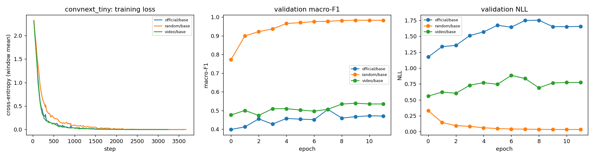
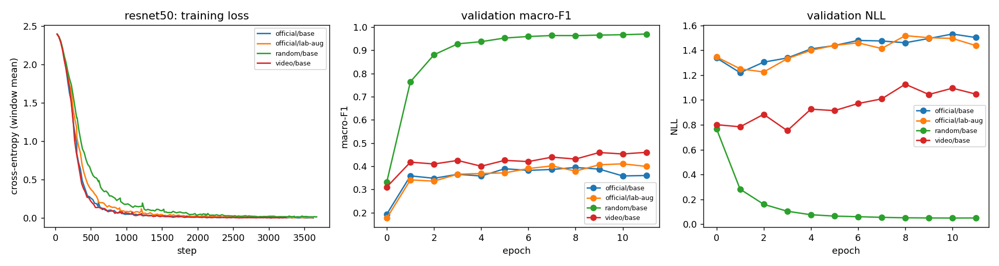
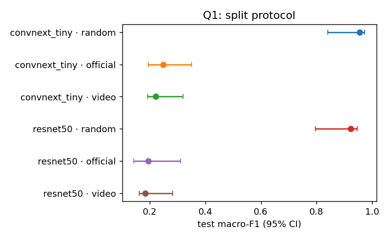
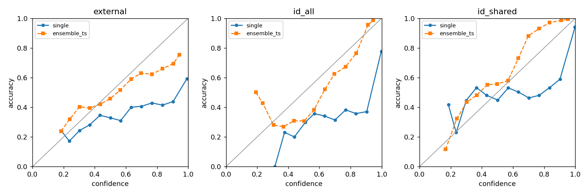
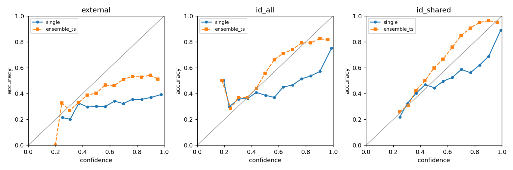
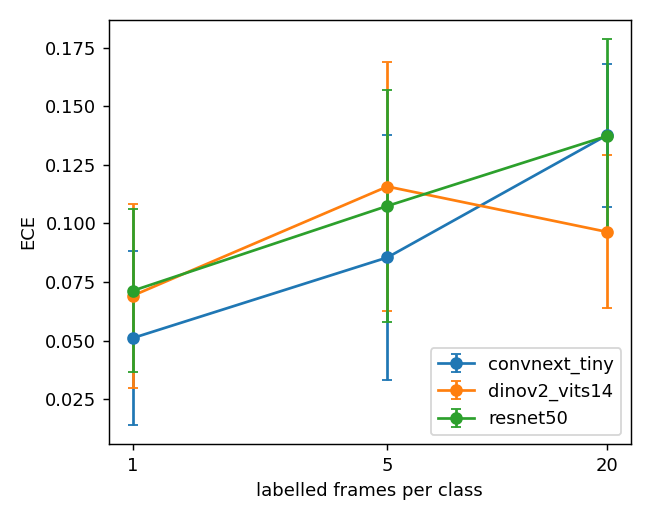
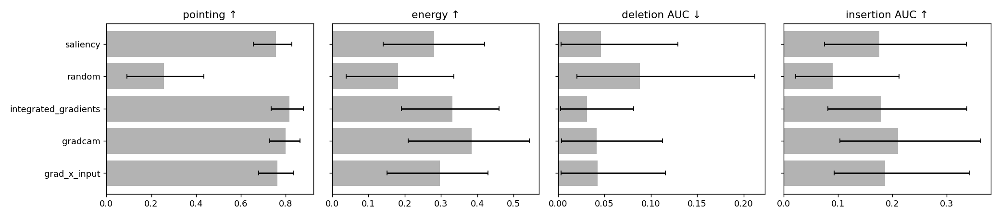
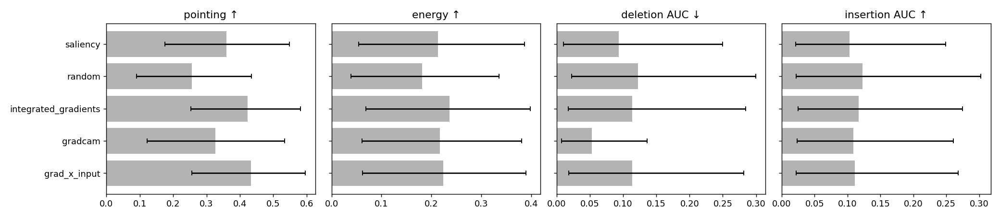
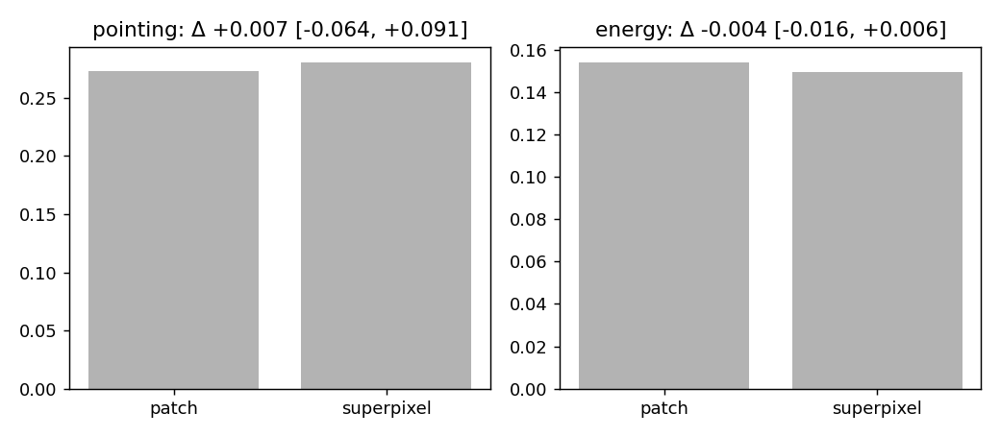
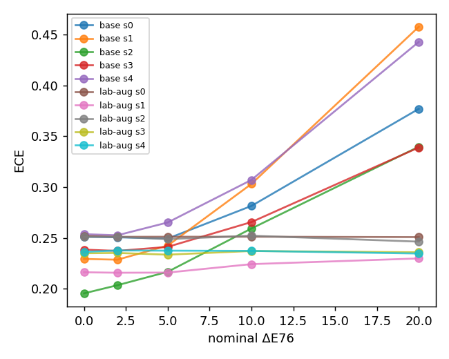

# Results

Generated by `cxa report` from `runs/`. Do not edit by hand.

## Training

| run group | seeds | epochs run | best epoch | best val macro-F1 | minutes |
| --- | --- | --- | --- | --- | --- |
| official/convnext_tiny/base/fold1 | 5 | 8.4 | 3.4 | 0.507 ± 0.020 | 16.5 |
| official/resnet50/base/fold1 | 5 | 9.4 | 4.6 | 0.408 ± 0.031 | 14.1 |
| official/resnet50/lab-aug/fold1 | 5 | 10.6 | 6.4 | 0.424 ± 0.034 | 13.6 |
| random/convnext_tiny/base/fold1 | 5 | 12.0 | 9.2 | 0.984 ± 0.003 | 20.8 |
| random/resnet50/base/fold1 | 5 | 11.8 | 9.2 | 0.969 ± 0.006 | 18.5 |
| video/convnext_tiny/base/fold1 | 5 | 9.2 | 5.2 | 0.539 ± 0.012 | 15.1 |
| video/resnet50/base/fold1 | 5 | 8.8 | 4.8 | 0.463 ± 0.025 | 11.5 |

Per-run values: `training_runs.csv`. Curves: mean over seeds.

## Q1 — split leakage

| backbone | test fold | protocol | seeds | macro-F1 |
| --- | --- | --- | --- | --- |
| convnext_tiny | 1 | random | 5 | 0.955 [0.842, 0.974] |
| convnext_tiny | 1 | official | 5 | 0.247 [0.193, 0.350] |
| convnext_tiny | 1 | video | 5 | 0.220 [0.193, 0.319] |
| resnet50 | 1 | random | 5 | 0.924 [0.797, 0.946] |
| resnet50 | 1 | official | 5 | 0.194 [0.142, 0.311] |
| resnet50 | 1 | video | 5 | 0.183 [0.162, 0.283] |

| backbone | test fold | difference | macro-F1 [95% CI] |
| --- | --- | --- | --- |
| convnext_tiny | 1 | official − video | 0.027 [-0.080, 0.121] |
| convnext_tiny | 1 | random − official | 0.708 [0.539, 0.755] |
| convnext_tiny | 1 | random − video | 0.735 [0.568, 0.761] |
| resnet50 | 1 | official − video | 0.011 [-0.094, 0.115] |
| resnet50 | 1 | random − official | 0.730 [0.540, 0.773] |
| resnet50 | 1 | random − video | 0.741 [0.562, 0.761] |

95% intervals: video-cluster bootstrap, seeds averaged within each replicate. `random − official` is the pre-registered contrast (H1); `official − video` measures the leakage left in the official split (7 of 43 videos in both folds).

Macro-F1 averaged over the 9 classes present in every protocol's test set (Angiectasia, Blood, Erosion, Ileo-cecal valve, Lymphangiectasia, Normal, Pylorus, Reduced Mucosal View, Ulcer), so that protocols are compared on one class set:

| backbone | protocol or difference | macro-F1 [95% CI] |
| --- | --- | --- |
| convnext_tiny | random | 0.961 [0.758, 0.975] |
| convnext_tiny | official | 0.244 [0.182, 0.280] |
| convnext_tiny | video | 0.220 [0.173, 0.251] |
| convnext_tiny | official − video | 0.023 [-0.046, 0.080] |
| convnext_tiny | random − official | 0.717 [0.537, 0.776] |
| convnext_tiny | random − video | 0.741 [0.549, 0.787] |
| resnet50 | random | 0.939 [0.744, 0.955] |
| resnet50 | official | 0.184 [0.150, 0.231] |
| resnet50 | video | 0.183 [0.153, 0.215] |
| resnet50 | official − video | 0.001 [-0.046, 0.057] |
| resnet50 | random − official | 0.754 [0.560, 0.787] |
| resnet50 | random − video | 0.756 [0.560, 0.785] |

## Q2 — calibration under shift

### official/convnext_tiny/base/fold1 (seeds [0, 1, 2, 3, 4])

| domain | condition | ECE | NLL | Brier | macro-F1 |
| --- | --- | --- | --- | --- | --- |
| external | ensemble | 0.209 [0.201, 0.218] | 1.754 [1.718, 1.788] | 0.703 [0.692, 0.715] | 0.193 [0.184, 0.202] |
| external | ensemble_ts | 0.082 [0.074, 0.091] | 1.471 [1.449, 1.493] | 0.657 [0.648, 0.666] | 0.193 [0.184, 0.202] |
| external | single | 0.337 [0.330, 0.344] | 2.701 [2.654, 2.748] | 0.842 [0.831, 0.855] | 0.186 [0.179, 0.192] |
| external | single_ts | 0.154 [0.149, 0.161] | 1.633 [1.613, 1.654] | 0.719 [0.710, 0.728] | 0.186 [0.179, 0.192] |
| id_all | ensemble | 0.149 [0.065, 0.250] | 1.008 [0.540, 1.611] | 0.385 [0.226, 0.583] | 0.253 [0.201, 0.359] |
| id_all | ensemble_ts | 0.080 [0.041, 0.153] | 0.821 [0.506, 1.213] | 0.344 [0.213, 0.506] | 0.253 [0.201, 0.359] |
| id_all | single | 0.206 [0.121, 0.313] | 1.598 [0.936, 2.408] | 0.459 [0.284, 0.676] | 0.247 [0.193, 0.350] |
| id_all | single_ts | 0.089 [0.051, 0.159] | 0.922 [0.607, 1.301] | 0.382 [0.247, 0.546] | 0.247 [0.193, 0.350] |
| id_shared | ensemble | 0.023 [0.009, 0.083] | 0.409 [0.158, 0.797] | 0.158 [0.069, 0.290] | 0.249 [0.193, 0.399] |
| id_shared | ensemble_ts | 0.067 [0.046, 0.108] | 0.416 [0.222, 0.692] | 0.164 [0.082, 0.275] | 0.249 [0.193, 0.399] |
| id_shared | single | 0.063 [0.031, 0.130] | 0.577 [0.247, 1.086] | 0.193 [0.091, 0.340] | 0.246 [0.194, 0.384] |
| id_shared | single_ts | 0.065 [0.054, 0.099] | 0.464 [0.272, 0.725] | 0.183 [0.100, 0.298] | 0.246 [0.194, 0.384] |

H2b, external − ID ECE after scaling: single 0.089 [0.056, 0.102], ensemble 0.015 [-0.027, 0.036].
H2a, ensemble − single on external: ECE -0.128 [-0.132, -0.123], NLL -0.948 [-0.967, -0.929], Brier -0.139 [-0.141, -0.137].

### official/resnet50/base/fold1 (seeds [0, 1, 2, 3, 4])

| domain | condition | ECE | NLL | Brier | macro-F1 |
| --- | --- | --- | --- | --- | --- |
| external | ensemble | 0.285 [0.276, 0.294] | 2.305 [2.263, 2.346] | 0.843 [0.832, 0.855] | 0.135 [0.130, 0.141] |
| external | ensemble_ts | 0.126 [0.117, 0.135] | 1.771 [1.747, 1.795] | 0.763 [0.755, 0.772] | 0.135 [0.130, 0.141] |
| external | single | 0.421 [0.414, 0.428] | 3.105 [3.056, 3.156] | 0.986 [0.974, 0.998] | 0.132 [0.128, 0.136] |
| external | single_ts | 0.203 [0.197, 0.210] | 1.905 [1.882, 1.928] | 0.825 [0.816, 0.834] | 0.132 [0.128, 0.136] |
| id_all | ensemble | 0.158 [0.064, 0.276] | 1.505 [0.878, 2.265] | 0.473 [0.298, 0.678] | 0.208 [0.140, 0.335] |
| id_all | ensemble_ts | 0.075 [0.053, 0.151] | 1.125 [0.755, 1.571] | 0.453 [0.312, 0.616] | 0.208 [0.140, 0.335] |
| id_all | single | 0.227 [0.134, 0.337] | 1.899 [1.157, 2.785] | 0.537 [0.357, 0.743] | 0.194 [0.142, 0.311] |
| id_all | single_ts | 0.078 [0.053, 0.162] | 1.186 [0.827, 1.608] | 0.485 [0.347, 0.641] | 0.194 [0.142, 0.311] |
| id_shared | ensemble | 0.052 [0.015, 0.134] | 0.697 [0.320, 1.230] | 0.240 [0.120, 0.402] | 0.173 [0.125, 0.329] |
| id_shared | ensemble_ts | 0.073 [0.032, 0.124] | 0.611 [0.372, 0.945] | 0.247 [0.149, 0.382] | 0.173 [0.125, 0.329] |
| id_shared | single | 0.101 [0.044, 0.186] | 0.884 [0.433, 1.510] | 0.282 [0.154, 0.454] | 0.172 [0.131, 0.317] |
| id_shared | single_ts | 0.072 [0.040, 0.124] | 0.666 [0.435, 0.978] | 0.275 [0.176, 0.407] | 0.172 [0.131, 0.317] |

H2b, external − ID ECE after scaling: single 0.131 [0.078, 0.163], ensemble 0.054 [0.001, 0.096].
H2a, ensemble − single on external: ECE -0.136 [-0.141, -0.132], NLL -0.801 [-0.815, -0.786], Brier -0.142 [-0.144, -0.140].

## Q3 — few-shot linear probes

| backbone | shots/class | ECE | macro-F1 |
| --- | --- | --- | --- |
| convnext_tiny | 1 | 0.051 [0.019, 0.122] | 0.087 [0.052, 0.113] |
| convnext_tiny | 5 | 0.086 [0.022, 0.162] | 0.116 [0.093, 0.140] |
| convnext_tiny | 20 | 0.138 [0.104, 0.192] | 0.140 [0.124, 0.151] |
| convnext_tiny | all | 0.137 | 0.182 |
| dinov2_vits14 | 1 | 0.069 [0.022, 0.131] | 0.095 [0.073, 0.141] |
| dinov2_vits14 | 5 | 0.116 [0.041, 0.197] | 0.122 [0.105, 0.153] |
| dinov2_vits14 | 20 | 0.096 [0.047, 0.143] | 0.162 [0.148, 0.191] |
| dinov2_vits14 | all | 0.126 | 0.199 |
| resnet50 | 1 | 0.071 [0.016, 0.108] | 0.080 [0.056, 0.104] |
| resnet50 | 5 | 0.107 [0.035, 0.181] | 0.103 [0.082, 0.127] |
| resnet50 | 20 | 0.137 [0.083, 0.196] | 0.128 [0.115, 0.143] |
| resnet50 | all | 0.121 | 0.159 |

Lowest ECE at k=1: convnext_tiny < dinov2_vits14 < resnet50 (mean over draws; intervals are 2.5–97.5% of draws).

## Q4 — explanation methods

### train/official/convnext_tiny/base/fold1/seed0 (300 boxed frames, 10 videos)

| method | pointing ↑ | energy ↑ | deletion AUC ↓ | insertion AUC ↑ |
| --- | --- | --- | --- | --- |
| grad_x_input | 0.763 [0.680, 0.837] | 0.298 [0.151, 0.430] | 0.043 [0.003, 0.116] | 0.187 [0.093, 0.342] |
| gradcam | 0.800 [0.730, 0.864] | 0.384 [0.209, 0.543] | 0.042 [0.004, 0.112] | 0.211 [0.103, 0.363] |
| integrated_gradients | 0.817 [0.737, 0.880] | 0.332 [0.191, 0.460] | 0.031 [0.003, 0.082] | 0.180 [0.081, 0.337] |
| random | 0.257 [0.090, 0.435] | 0.181 [0.039, 0.336] | 0.088 [0.020, 0.212] | 0.090 [0.022, 0.213] |
| saliency | 0.757 [0.657, 0.829] | 0.281 [0.141, 0.421] | 0.046 [0.003, 0.129] | 0.176 [0.075, 0.336] |

Kendall tau between method rankings:

| metric pair | tau [95% CI] |
| --- | --- |
| energy~deletion_auc | 0.80 [0.00, 0.80] |
| energy~insertion_auc | 0.80 [0.20, 1.00] |
| insertion_auc~deletion_auc | 0.60 [-0.20, 0.80] |
| pointing~deletion_auc | 1.00 [0.00, 1.00] |
| pointing~energy | 0.80 [0.40, 1.00] |
| pointing~insertion_auc | 0.60 [0.00, 0.80] |

Model accuracy on these frames: 0.13. Pointing and deletion AUC split by whether the model classifies the frame correctly:

| frames | method | pointing ↑ | deletion AUC ↓ |
| --- | --- | --- | --- |
| correct (38 frames, 5 videos) | grad_x_input | 0.868 [0.500, 0.975] | 0.304 [0.033, 0.477] |
| correct (38 frames, 5 videos) | gradcam | 0.868 [0.500, 0.975] | 0.285 [0.052, 0.425] |
| correct (38 frames, 5 videos) | integrated_gradients | 0.947 [0.800, 1.000] | 0.220 [0.034, 0.421] |
| correct (38 frames, 5 videos) | random | 0.342 [0.048, 0.480] | 0.511 [0.145, 0.714] |
| correct (38 frames, 5 videos) | saliency | 0.816 [0.438, 0.920] | 0.308 [0.037, 0.462] |
| wrong (262 frames, 9 videos) | grad_x_input | 0.748 [0.670, 0.817] | 0.005 [0.001, 0.014] |
| wrong (262 frames, 9 videos) | gradcam | 0.790 [0.720, 0.844] | 0.007 [0.001, 0.021] |
| wrong (262 frames, 9 videos) | integrated_gradients | 0.798 [0.714, 0.863] | 0.004 [0.001, 0.010] |
| wrong (262 frames, 9 videos) | random | 0.244 [0.086, 0.426] | 0.027 [0.009, 0.058] |
| wrong (262 frames, 9 videos) | saliency | 0.748 [0.650, 0.821] | 0.008 [0.001, 0.027] |

Sanity check (Spearman with original map after randomising all layer groups):

| method | Spearman (last step) |
| --- | --- |
| grad_x_input | 0.368 |
| gradcam | -0.057 |
| integrated_gradients | 0.416 |
| random | n/a |
| saliency | 0.233 |

### train/official/resnet50/base/fold1/seed0 (300 boxed frames, 10 videos)

| method | pointing ↑ | energy ↑ | deletion AUC ↓ | insertion AUC ↑ |
| --- | --- | --- | --- | --- |
| grad_x_input | 0.433 [0.255, 0.597] | 0.224 [0.062, 0.390] | 0.114 [0.018, 0.282] | 0.111 [0.022, 0.268] |
| gradcam | 0.327 [0.122, 0.535] | 0.217 [0.061, 0.381] | 0.053 [0.007, 0.136] | 0.109 [0.023, 0.261] |
| integrated_gradients | 0.423 [0.254, 0.581] | 0.236 [0.069, 0.399] | 0.113 [0.017, 0.285] | 0.117 [0.025, 0.274] |
| random | 0.257 [0.090, 0.435] | 0.181 [0.039, 0.336] | 0.123 [0.022, 0.299] | 0.123 [0.022, 0.302] |
| saliency | 0.360 [0.175, 0.549] | 0.213 [0.054, 0.387] | 0.093 [0.010, 0.250] | 0.103 [0.021, 0.249] |

Kendall tau between method rankings:

| metric pair | tau [95% CI] |
| --- | --- |
| energy~deletion_auc | 0.20 [-0.20, 0.60] |
| energy~insertion_auc | 0.20 [-0.20, 0.60] |
| insertion_auc~deletion_auc | -0.60 [-0.80, 0.20] |
| pointing~deletion_auc | -0.20 [-0.40, 0.20] |
| pointing~energy | 0.60 [0.20, 1.00] |
| pointing~insertion_auc | -0.20 [-0.40, 0.40] |

Model accuracy on these frames: 0.10. Pointing and deletion AUC split by whether the model classifies the frame correctly:

| frames | method | pointing ↑ | deletion AUC ↓ |
| --- | --- | --- | --- |
| correct (30 frames, 5 videos) | grad_x_input | 0.767 [0.000, 0.932] | 0.679 [0.052, 0.760] |
| correct (30 frames, 5 videos) | gradcam | 0.833 [0.000, 0.912] | 0.379 [0.028, 0.443] |
| correct (30 frames, 5 videos) | integrated_gradients | 0.767 [0.000, 0.853] | 0.693 [0.080, 0.768] |
| correct (30 frames, 5 videos) | random | 0.467 [0.000, 0.571] | 0.726 [0.087, 0.796] |
| correct (30 frames, 5 videos) | saliency | 0.633 [0.000, 0.697] | 0.613 [0.043, 0.702] |
| wrong (270 frames, 10 videos) | grad_x_input | 0.396 [0.255, 0.557] | 0.051 [0.017, 0.120] |
| wrong (270 frames, 10 videos) | gradcam | 0.270 [0.124, 0.433] | 0.017 [0.007, 0.035] |
| wrong (270 frames, 10 videos) | integrated_gradients | 0.385 [0.258, 0.518] | 0.049 [0.015, 0.119] |
| wrong (270 frames, 10 videos) | random | 0.233 [0.086, 0.433] | 0.056 [0.021, 0.127] |
| wrong (270 frames, 10 videos) | saliency | 0.330 [0.176, 0.526] | 0.036 [0.009, 0.094] |

Sanity check (Spearman with original map after randomising all layer groups):

| method | Spearman (last step) |
| --- | --- |
| grad_x_input | 0.339 |
| gradcam | 0.023 |
| integrated_gradients | 0.337 |
| random | n/a |
| saliency | 0.182 |

## Slice A — superpixel units

| metric | patch | superpixel | superpixel − patch |
| --- | --- | --- | --- |
| pointing | 0.273 | 0.280 | 0.007 [-0.064, 0.091] |
| energy | 0.154 | 0.150 | -0.004 [-0.016, 0.006] |

Probe test macro-F1 0.197 (identical for both units); 300 frames, mean 58 superpixels.

## Slice B — colour shift (simulation)

| run | ECE slope / ΔE | Spearman(ΔE, ECE) | gap recovered F1 | gap recovered ECE |
| --- | --- | --- | --- | --- |
| train/official/resnet50/base/fold1/seed0 | 0.0065 | 0.60 | n/a (gap +0.047) | -0.08 |
| train/official/resnet50/base/fold1/seed1 | 0.0119 | 0.90 | n/a (gap +0.042) | -0.01 |
| train/official/resnet50/base/fold1/seed2 | 0.0074 | 1.00 | n/a (gap +0.025) | -0.17 |
| train/official/resnet50/base/fold1/seed3 | 0.0052 | 0.90 | n/a (gap +0.031) | -0.07 |
| train/official/resnet50/base/fold1/seed4 | 0.0098 | 0.90 | n/a (gap +0.024) | -0.11 |
| train/official/resnet50/lab-aug/fold1/seed0 | -0.0000 | -0.60 | -0.01 | 0.05 |
| train/official/resnet50/lab-aug/fold1/seed1 | 0.0008 | 0.70 | n/a (gap +0.023) | -0.10 |
| train/official/resnet50/lab-aug/fold1/seed2 | -0.0002 | -0.30 | 0.09 | 0.09 |
| train/official/resnet50/lab-aug/fold1/seed3 | 0.0001 | 0.60 | n/a (gap +0.049) | -0.03 |
| train/official/resnet50/lab-aug/fold1/seed4 | -0.0001 | -0.40 | n/a (gap +0.028) | 0.00 |

lab-aug_minus_base_ece_slope: -0.0081 [-0.0102, -0.0061] (bootstrap over seeds; with fewer than 10 seeds report as an observation).

Simulation only: no psychophysical validation and no display calibration.
